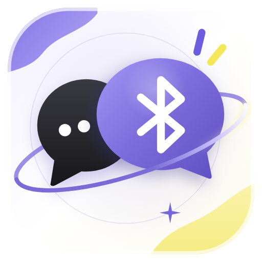
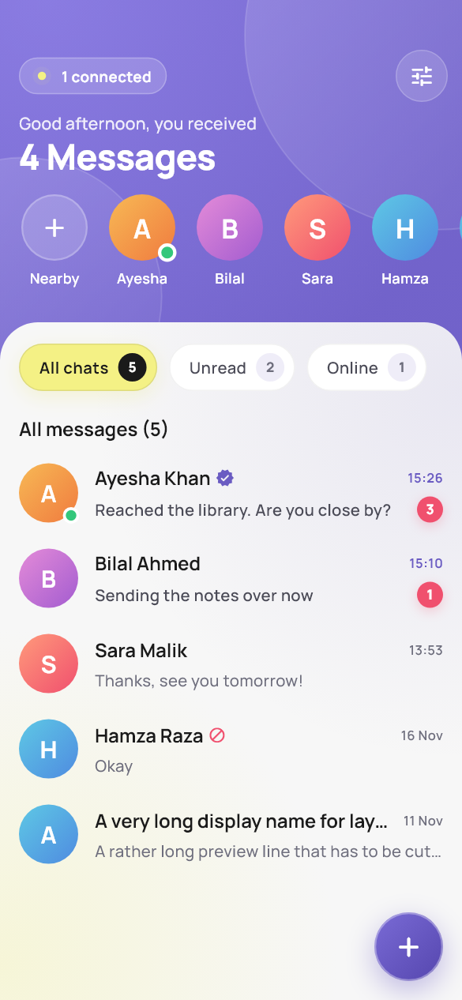
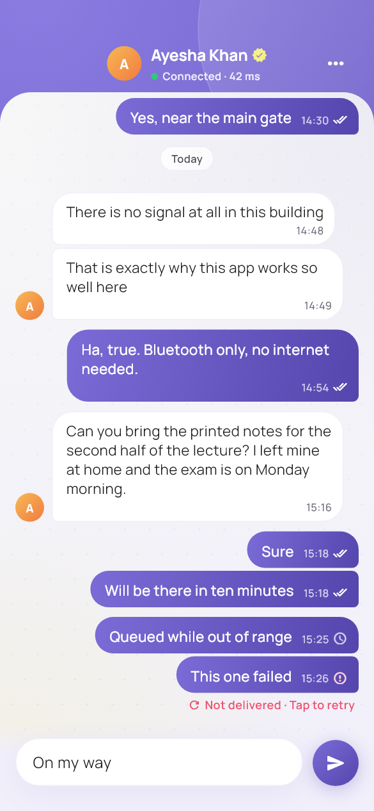
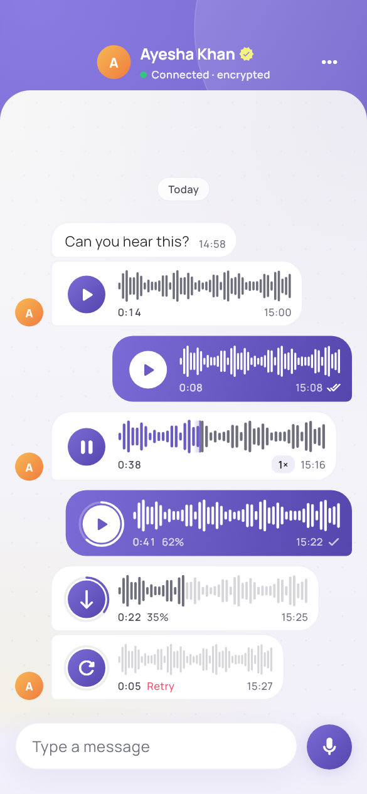
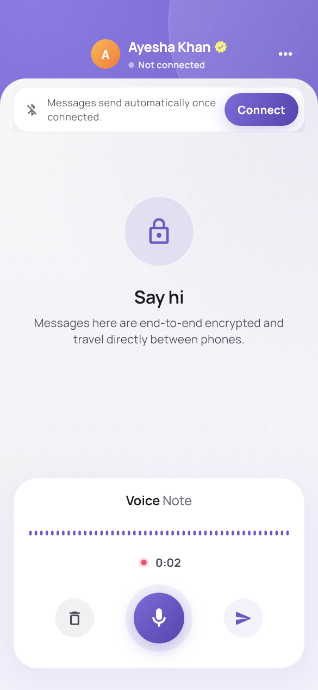
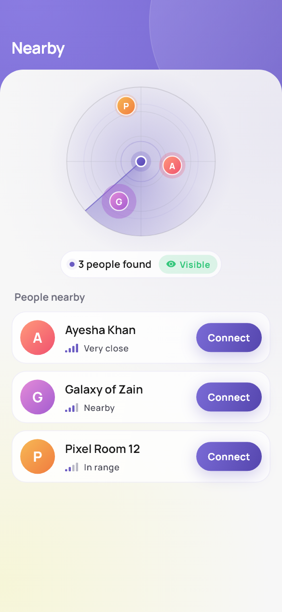
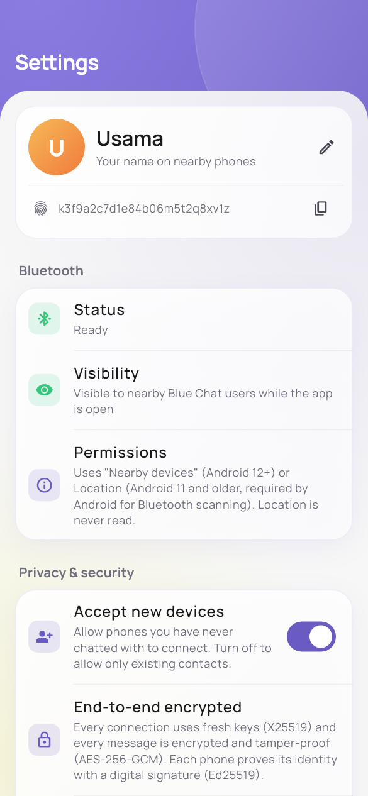

<p align="center">
  
</p>

<h1 align="center">Blue Chat</h1>

<p align="center">
  Offline, peer-to-peer, end-to-end encrypted chat over Bluetooth Low Energy.<br>
  No internet, servers, accounts, or cloud services. Android only for now.
</p>

<p align="center">
  
  
  
</p>
<p align="center">
  
  
  
</p>

> Formerly **U Chat**. The repository, package name, database and Bluetooth
> protocol identifiers keep the old `u_chat` / `"UC"` names on purpose, so
> existing installs keep their chats and can still talk to each other.

## Features

**Chatting**
- Find nearby Blue Chat users on a live radar and connect with one tap. Each person shows how close they are ("Very close", "Nearby", "In range").
- Text chat with delivery status: Pending → Sending → Sent → Delivered (or Failed, tap to retry).
- Voice messages: hold the mic to record, slide left to cancel, slide up to lock hands-free. Up to 2 minutes, with a live waveform, seeking and playback speed.
- Home screen with a contact strip, unread count, and All / Unread / Online filters.

**Reliability**
- ACK after the receiver stores the message, with retries, duplicate protection and in-order delivery.
- Automatic reconnection after unexpected drops. Queued messages are sent when a contact comes back.
- Voice transfers resume where they stopped after a drop, and a lost "got it" is recovered on the next connection.

**Privacy**
- End-to-end encryption with a signed handshake, plus safety numbers to verify contacts in person.
- Block contacts, or refuse connections from devices you've never chatted with.
- Chat history stored only on the phone (SQLite / Drift) and kept across restarts.

**Design**
- "Lavender Glass" theme: a lavender header (`#6A5BC2`) over light frosted sheets (`#F7F7F7`), ink text (`#1A1A1A`) and lemon highlights (`#F4F185`), set in Manrope.
- Animated throughout (sheets rising in, staggered lists, message arrivals, a pulsing recorder), and every animation respects Android's "Remove animations" setting.
- Responsive from small phones to tablets and landscape, and tested at 1.5× text size.

## Build and run

```bash
flutter pub get
dart run build_runner build      # regenerates Drift code after schema changes
flutter test                     # unit, protocol and UI tests (no device needed)
flutter run                      # needs a physical Android phone (emulators have no BLE)
```

Requirements: Android 7.0+ (API 24) with Bluetooth Low Energy. To test chatting
you need two phones. See [docs/TESTING.md](docs/TESTING.md).

## Screenshots without a phone

`test/ui` renders every screen at four sizes, at normal and large text, and fails
on any layout overflow. The images above come from it. To save the frames as PNGs:

```bash
FLUTTER_ROOT=/path/to/flutter UI_SHOTS_DIR=some/dir flutter test test/ui
```

## App icon

The launcher icon is drawn in code from the logo in
[`tool/brand/blue_chat_logo_source.png`](tool/brand/blue_chat_logo_source.png).
One command writes every Android density: adaptive layers for Android 8+, a
monochrome layer for Android 13 themed icons, a classic icon for Android 7, and
a 512px store icon.

```bash
flutter test tool/render_app_icon.dart
```

## Architecture

```
lib/
  app/            routes, theme, startup dependency wiring (AppDependencies)
    theme/        Lavender Glass colours, Manrope text theme, shared motion timing
    widgets/      app scaffold (header + sheet), surfaces, buttons, avatars, radar, overlays, responsive rules
  core/
    bluetooth/    radio layer
      bluetooth_service.dart   owns availability, advertising, scanning, sessions, reconnection
      ble_advertiser.dart      manufacturer-data advertising ("UC" + ID prefix + name)
      ble_scanner.dart         filtered, self-expiring discovery list
      ble_gatt_server.dart     peripheral role: GATT service, RX writes, TX notifications
      ble_connector.dart       central role: connect, MTU, service discovery, subscribe
      link/                    BleLink (one GATT connection), PeerSession (protocol state)
      transport/               packet fragmentation, frame format, HELLO/PROFILE codecs
    messaging/    MessagingService (queue, ACKs, retries), voice transfer, message protocol, PeerTransport interface
    voice/        recorder, player, audio file store, voice metadata
    security/     identity key, handshake + session cipher, safety numbers, peer policy
    database/     Drift tables and DAOs
  data/           models and repositories
  modules/        home, nearby_devices, chat, contact, settings (GetX binding/controller/view)
tool/             launcher icon renderer and brand source files
```

Dependencies only flow downwards: views → controllers → repositories/services →
Bluetooth. Controllers never touch BLE bytes, and the BLE plugin is only imported
under `core/bluetooth/`.

## Protocol

| Layer | Format |
|---|---|
| Advertisement | Manufacturer data `0xFFFF`: `"UC"`, version, 8-char device-ID prefix, display name (≤ 13 bytes) |
| GATT | Service `b7e3c1a0-…`; RX `…c1a1` (write with response, central → peripheral); TX `…c1a2` (notify, peripheral → central) |
| Packet | 7-byte header (version/flags, transferId, index, total) + chunk; sized to the negotiated MTU |
| Frame | `[type][body]`: `hello`, `auth`, `sealed` in the clear; everything else only inside `sealed` |
| Message | JSON `{v,id,senderId,receiverId,type,content,timestamp,seq}`; ACK `{ids:[…]}` |
| Voice | A `message` frame of type `voice` carries size, SHA-256 and waveform. The receiver then pulls the audio: `voiceRequest {id, offset}` → `voiceChunk` (binary, up to 8 KB) → `voiceDone` once the hash matches. Re-offering a note the receiver already has gets another `voiceDone`. |

### Security

- **Identity:** an Ed25519 key pair created on first launch and stored in Android Keystore-backed secure storage. Device ID = base32(SHA-256(public key)[0..16]), so an ID can't be claimed without its key.
- **Handshake (per connection):** HELLO carries the identity key, a fresh X25519 key and a nonce. Each side then signs the transcript of both HELLOs (AUTH). This proves key possession and binds the ephemeral keys, so a man in the middle can't swap them.
- **Session keys:** HKDF-SHA256 over the X25519 shared secret, salted with the transcript, with one AES-256 key per direction. Fresh keys each connection give forward secrecy.
- **Encryption:** AES-256-GCM. A counter-based nonce, authenticated as AAD, must strictly increase, so replayed, reordered or tampered frames close the connection.
- **Verification:** a 30-digit safety number derived from both identity keys, compared in person.
- **Policy:** blocked contacts are refused in both directions after authentication. With "Accept new devices" off, unknown phones that connect to you are refused. Phones you choose to connect to are always allowed.
- **At rest:** app-private storage covered by Android file-based encryption. `allowBackup=false`.

All cryptography comes from the `cryptography` package (native-accelerated via `cryptography_flutter`). Nothing is home-made beyond composing these primitives in the standard signed-DH pattern.

## Known limitations

- **Android only.** iOS was deferred; the architecture allows adding it.
- **Foreground only.** Advertising and scanning pause in the background. Background messaging needs an Android foreground service.
- **1:1 chats, direct range only.** No groups or multi-hop relaying.
- **Voice notes take time to send.** About 3 KB per second of audio over Bluetooth, with a progress ring on the bubble. Both phones must stay in range with the app open; transfers resume after a drop. Phones on older versions of the app show the note as not delivered.
- **Unverified first contact is trust-on-first-use.** Compare safety numbers to rule out a man in the middle at first contact.
- **A refused connection briefly looks connected.** When the other phone refuses you (blocked, or not accepting new devices), the chat opens for a moment before the link drops. Fixing this needs a handshake change on both sides.
- **Before publishing:** register a Bluetooth SIG company ID (replace `0xFFFF` in `ble_constants.dart`) and configure release signing (currently the debug key).
- **Android 11 and older:** Location must be switched on for BLE scans to return results.
